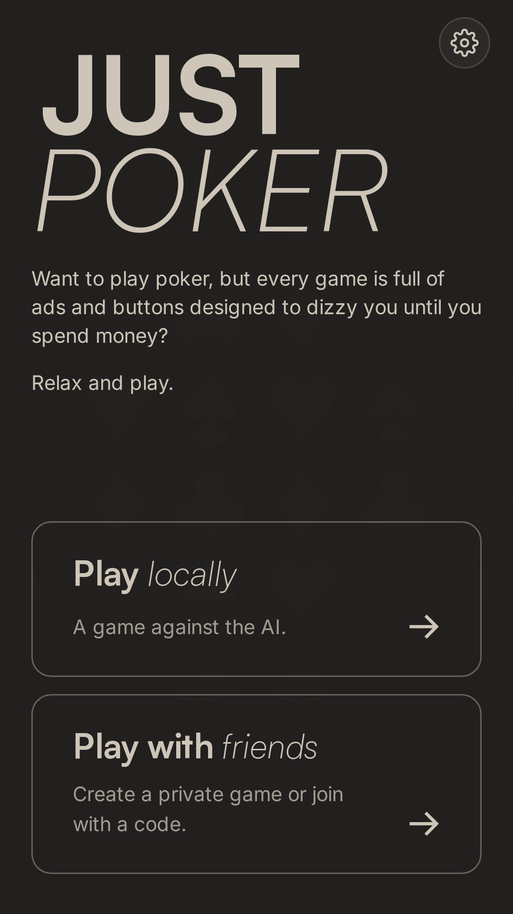
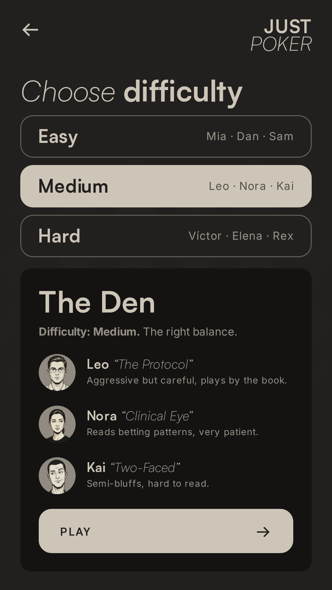
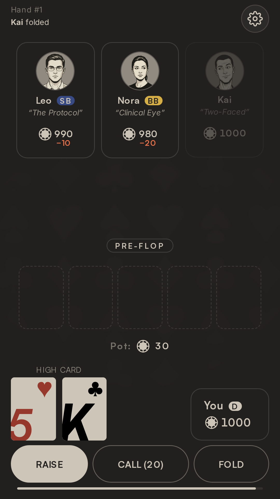
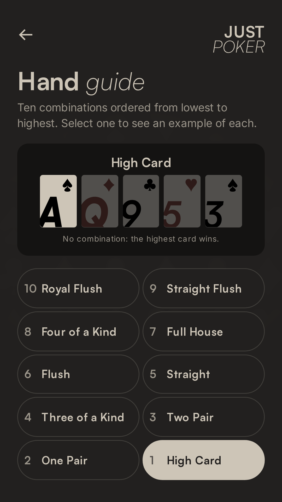
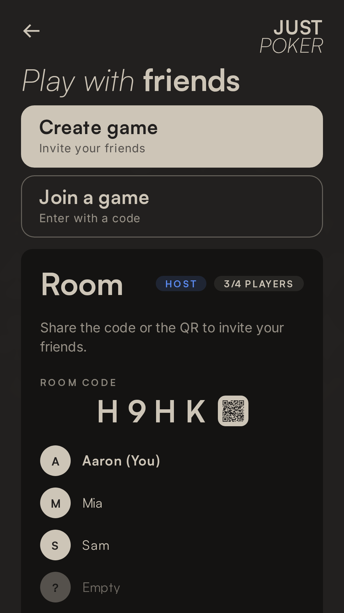

# Just Poker

A free, no-real-money poker game you can open and play right away: a **single-player
match against AI opponents** offline, plus a **private online table for 2–4 friends**.

> Practice poker. No real money, no sign-up, no gambling.

## Features

- **Open and play** — no account, no onboarding friction.
- **Single-player offline** — play against AI opponents with several tables and
  difficulty levels. Works with no connection.
- **Private online multiplayer** — 2–4 real players in a private room. Share a
  4-character code, a link or a QR code; identity is anonymous.
- **Hand rankings guide** — a built-in reference for hand values.
- **Save & resume** — an in-progress local game is restored when you come back.
- **Sound, music and haptics** — with settings to tune or disable them.
- **Spanish & English** — auto-detected from the browser and switchable in settings.
- **Android app** — the same web app packaged with Capacitor.

## Screenshots

| Menu | Table selection | Table |
| --- | --- | --- |
|  |  |  |

| Hand rankings | Online lobby |
| --- | --- |
|  |  |

## Tech stack

- **UI:** React 19 + TypeScript, Vite, Tailwind CSS v4 (CSS-first `@theme` tokens),
  framer-motion for transitions, Zustand for state.
- **Game engine:** a self-contained poker engine with an extensive test suite.
- **AI:** heuristic opponents with per-personality profiles.
- **Online:** socket.io, fanned out through a Vercel Function backed by Redis.
- **Mobile:** Capacitor 8 (Android); the single-player mode is fully offline.

## Getting started

Requires Node.js and npm.

```bash
npm install
npm run dev
```

Then open the URL printed by Vite (default `http://localhost:5173`).

### Scripts

| Command | What it does |
| --- | --- |
| `npm run dev` | Web dev server (Vite). |
| `npm run dev:server` | Online dev server (socket.io) on port 3001. |
| `npm run dev:all` | Web and online server together. |
| `npm run build` | Type-check and build for production into `dist/`. |
| `npm run preview` | Preview the production build locally. |
| `npm run lint` | Lint the source with oxlint. |
| `npm test` | Run the test suite (vitest). |
| `npm run test:ai` | AI behavior benchmark. |
| `npm run test:online` | Online smoke test (needs `dev:server` running). |
| `npm run android` | Build the signed Android APK/AAB. |
| `npm run android:debug` | Build a debug Android APK. |
| `npm run store:assets` | Regenerate the store icon and feature graphic. |
| `npm run store:screenshots` | Regenerate the store screenshots (append `es` for Spanish). |

### Online in development

The web client talks to the online server over `/api/socket-io`; Vite proxies that
path (including WebSockets) to `http://localhost:3001`. Start both processes with
`npm run dev:all`. In production the same path is served by a Vercel Function, which
uses Redis (set `REDIS_URL`) to share rooms across instances; without it the server
falls back to a single-instance in-memory registry.

## Internationalization

The app ships in **Spanish and English**. The starting language is auto-detected from
the browser and can be changed in the in-game settings.

## Deployment

- **Web (Vercel):** every push to `main` deploys automatically. The privacy policy is
  served at `/privacy-policy.html`.
- **Android (Capacitor / Google Play):** see [`store/PUBLISHING.md`](store/PUBLISHING.md)
  for the full release checklist. The Android build points at the production online
  server via `VITE_ONLINE_URL`.

## Documentation

- [`AGENTS.md`](AGENTS.md) — style guide, design tokens and conventions.
- [`ROADMAP.md`](ROADMAP.md) — project status and roadmap.
- [`store/PUBLISHING.md`](store/PUBLISHING.md) — Google Play publishing checklist.
- [`public/privacy-policy.html`](public/privacy-policy.html) — privacy policy.
